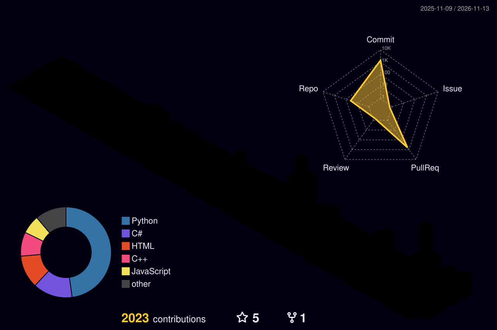

<p align="center">
  
</p>

<p align="center">
  <a href="https://github.com/Bor-Code">
    
  </a>
</p>

<p align="center">
  
  
  
  
  
  
  
  
</p>

<p align="center">
  
  
  
  
</p>

<p align="center">
  
</p>

##  `> whoami`

```text
Name        : Boran Kızılkaya
Role        : Computer Engineering Student
Domain      : Defensive Security / Malware Analysis / Threat Detection
Platform    : Windows, Linux
Mission     : Build practical security tools for malware analysis, threat detection and Windows telemetry
```

<p align="center">
  
</p>

<p align="center">
  
</p>

##  `> focus --areas`

<p align="center">
  
  
  
  
  
  
  
  
  
</p>

<p align="center">
  
</p>

##  `> ls ./case-files`

<table>
  <tr>
    <td width="50%" valign="top">
      <h3> CASE 01 — MalwareAnalysisTool</h3>
      <p>Windows-focused malware analysis tool for practicing static and dynamic analysis.</p>
      <ul>
        <li>Static inspection of executable files</li>
        <li>CLI-driven analysis workflow</li>
        <li>Dynamic analysis flow with timeout handling</li>
        <li>Structured suspicious behavior and event output</li>
      </ul>
      <p>
        
        
        
      </p>
      <a href="https://github.com/Bor-Code/MalwareAnalysisTool">
        
      </a>
    </td>
    <td width="50%" valign="top">
      <h3> CASE 02 — SentinelFlow</h3>
      <p>Defensive monitoring project focused on visibility, event analysis and detection-oriented engineering.</p>
      <ul>
        <li>Collection and structuring of security data</li>
        <li>Monitoring and visibility first design</li>
        <li>Blue Team fundamentals</li>
        <li>Detection logic and analysis workflows</li>
      </ul>
      <p>
        
        
        
      </p>
      <a href="https://github.com/Bor-Code/SentinelFlow">
        
      </a>
    </td>
  </tr>
  <tr>
    <td colspan="2" valign="top">
      <h3> CASE 03 — Detection &amp; Telemetry Lab </h3>
      <p>Controlled lab for simulating suspicious Windows behaviors and mapping detections to MITRE ATT&amp;CK techniques.</p>
      <ul>
        <li>Simulate suspicious behaviors in an isolated environment</li>
        <li>Collect Windows telemetry</li>
        <li>Map behaviors to MITRE ATT&amp;CK</li>
        <li>Write detection logic and document findings as case studies</li>
      </ul>
      <p>
        
        
        
        
      </p>
    </td>
  </tr>
</table>

<p align="center">
  <a href="https://github.com/Bor-Code/MalwareAnalysisTool"></a>
  <a href="https://github.com/Bor-Code/SentinelFlow"></a>
</p>

<p align="center">
  
</p>

##  `> stack --list`

<p align="center">
  
</p>

<table align="center">
  <tr>
    <td align="center" width="140"><br /><sub><b>Python</b></sub></td>
    <td align="center" width="140"><br /><sub><b>C++</b></sub></td>
    <td align="center" width="140"><br /><sub><b>C</b></sub></td>
    <td align="center" width="140"><br /><sub><b>PowerShell</b></sub></td>
    <td align="center" width="140"><br /><sub><b>Windows</b></sub></td>
    <td align="center" width="140"><br /><sub><b>Linux</b></sub></td>
  </tr>
</table>

<p align="center">
  
  
  
  
  
  
  
  
</p>

<p align="center">
  
</p>

##  `> learning --current`

<p align="center">
  
</p>

<p align="center">
  
  
  
</p>

<p align="center">
  
</p>

##  `> stats`

<p align="center">
  
  
</p>

<p align="center">
  
</p>

<p align="center">
  
</p>

<p align="center">
  
</p>

<p align="center">
  
</p>

<p align="center">
  <picture>
    <source media="(prefers-color-scheme: dark)" srcset="https://raw.githubusercontent.com/Bor-Code/Bor-Code/output/github-snake-dark.svg" />
    <source media="(prefers-color-scheme: light)" srcset="https://raw.githubusercontent.com/Bor-Code/Bor-Code/output/github-snake.svg" />
    
  </picture>
</p>

<p align="center">
  
</p>

##  `> contact`

<p align="center">
  <a href="https://github.com/Bor-Code">
    
  </a>
  <a href="https://www.linkedin.com/in/boran-k%C4%B1z%C4%B1lkaya-9324b5284/">
    
  </a>
  <a href="mailto:non.mrbora@gmail.com">
    
  </a>
</p>

<p align="center">
  
</p>
